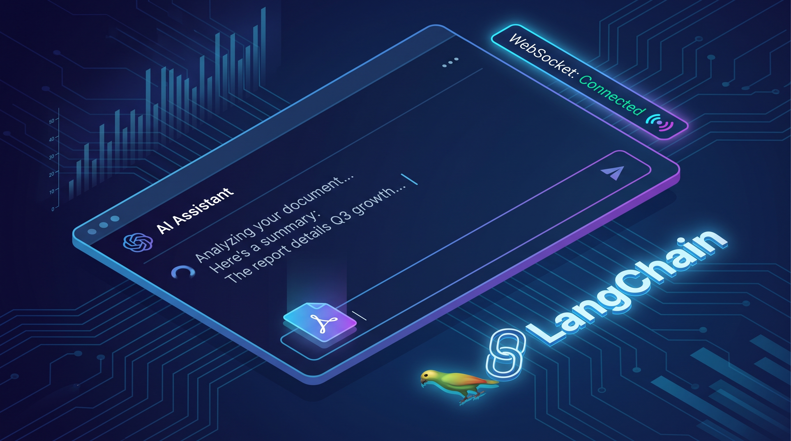

# Stateless Document-Aware AI Assistant - LangChain Implementation



<div align="center">


</div>

A **production-ready Stateless Document-Aware AI Assistant** built with LangChain, featuring WebSocket streaming, conversation memory, user authentication, search, export, and multi-format document support. Documents are ingested via REST API and their content is automatically injected into LLM context for intelligent document-aware responses.

## Features

- **Stateless Document-Aware Architecture**: Upload documents via REST API, content automatically injected into LLM context
- **WebSocket Streaming**: Real-time token-by-token streaming for enhanced user experience
- **Multi-File Upload**: Upload PDF, TXT, MD, and DOCX files with automatic text extraction
- **Conversation Memory**: SQLite-based persistent storage for conversation history
- **User Authentication**: JWT-based authentication with API keys
- **Chat History Search**: Full-text search across all conversations
- **Conversation Export**: Export sessions as JSON or plain text
- **Custom System Prompts**: Create and manage AI behavior presets
- **OpenAI & Gemini Support**: Works with both OpenAI GPT and Google Gemini models
- **Clean Architecture**: Modular design with separation of concerns

## Architecture

```
langchain-chatbot/
├── generic_agent/
│   ├── __init__.py
│   ├── agent.py         # Core chat agent with LLM integration
│   ├── router.py        # FastAPI routes for REST and WebSocket
│   ├── database.py      # SQLite-based conversation storage
│   ├── config.py        # Configuration management
│   ├── security.py      # Input validation and rate limiting
│   └── file_processor.py # Document processing utilities
├── data/                # Database storage
├── main.py              # FastAPI application entry point
├── requirements.txt     # Python dependencies
└── .env.example         # Environment variables template
```

## Stateless Document-Aware AI Architecture

The system implements a **Stateless Document-Aware AI Assistant** architecture where:

### Document Ingestion Flow (REST API)

```
1. User uploads documents via POST /api/v1/upload/documents
2. FileProcessor extracts text from PDF/TXT/MD/DOCX
3. Document content stored in SQLite via db.add_file()
4. System message added: "[Document: filename - N characters extracted]"
```

### Document Context Injection Flow (Chat)

```
1. User sends message via WebSocket or REST Chat API
2. System retrieves conversation history via db.get_conversation_context()
3. System retrieves uploaded file content via db.get_session_files()
4. Document content injected into system prompt:
   "=== UPLOADED DOCUMENTS ==="
   "--- filename.ext ---"
   "{document content}"
5. LLM generates response with document context
6. Response streamed token-by-token to client
```

### Key Benefits

- **Stateless**: Each request is self-contained with all necessary context
- **Document-Aware**: Uploaded files are automatically available to the AI
- **Memory Efficient**: No server-side session state; all context in request
- **Scalable**: Can run on serverless platforms without sticky sessions

## Installation

### Prerequisites

- Python 3.9 or higher
- pip or uv package manager

### Setup

1. **Clone the repository**

2. **Create a virtual environment**
   ```bash
   python -m venv venv
   source venv/bin/activate  # On Windows: venv\Scripts\activate
   ```

3. **Install dependencies**
   ```bash
   pip install -r requirements.txt
   ```

4. **Configure environment variables**
   ```bash
   cp .env.example .env
   # Edit .env with your API keys
   ```

5. **Run the application**
   ```bash
   python main.py
   ```

   Or with uvicorn:
   ```bash
   uvicorn main:app --host 0.0.0.0 --port 8000 --reload
   ```

## Configuration

Edit the `.env` file to configure the application:

```env
# AI Provider (openai or gemini)
AI_PROVIDER=openai

# OpenAI Configuration
OPENAI_API_KEY=sk-your-key-here
OPENAI_MODEL_NAME=gpt-4o-mini
OPENAI_BASE_URL=https://api.openai.com/v1
OPENAI_TEMPERATURE=0.7

# Server Configuration
HOST=0.0.0.0
PORT=8000
DEBUG=false
```

## API Documentation

All API endpoints are prefixed with `/api/v1`. Full Swagger/OpenAPI documentation available at `/docs` when the server is running.

### Authentication

The API supports two authentication methods:
- **X-API-Key Header**: Pass your API key in the `X-API-Key` header
- **Bearer Token**: Use JWT tokens obtained from `/api/v1/auth/login`

### WebSocket Chat

**Endpoint**: `ws://host:port/api/v1/ws/chat`

Connect to receive real-time streaming responses:

```javascript
const ws = new WebSocket('ws://localhost:8000/api/v1/ws/chat?api_key=YOUR_KEY');

ws.onopen = () => {
    ws.send(JSON.stringify({
        type: 'message',
        content: 'Hello, how are you?'
    }));
};

ws.onmessage = (event) => {
    const data = JSON.parse(event.data);
    if (data.type === 'token') {
        console.log(data.content);
    }
};
```

### REST Chat

**Endpoint**: `POST /api/v1/chat`

```bash
curl -X POST http://localhost:8000/api/v1/chat \
  -H "Content-Type: application/json" \
  -H "X-API-Key: YOUR_API_KEY" \
  -d '{"message": "Hello, how are you?"}'
```

**Request Headers**:
- `X-API-Key`: Your API key (required)
- `X-Provider`: AI provider - "openai" or "google" (default: openai)
- `X-Model`: Model name (default: gpt-4o-mini)
- `X-Base-URL`: Custom API base URL (optional)
- `X-System-Prompt`: Custom system prompt (optional)
- `X-Session-ID`: Session ID for conversation continuity (optional)
- `Authorization`: Bearer token (alternative to X-API-Key)

### Multi-File Upload

**Endpoint**: `POST /api/v1/upload/documents`

Upload multiple files (PDF, TXT, DOCX) for context:

```bash
curl -X POST http://localhost:8000/api/v1/upload/documents \
  -H "X-API-Key: YOUR_API_KEY" \
  -F "files=@document1.pdf" \
  -F "files=@document2.txt"
```

### Search Conversations

**Endpoint**: `POST /api/v1/search`

Search through conversation history:

```bash
curl -X POST http://localhost:8000/api/v1/search \
  -H "X-API-Key: YOUR_API_KEY" \
  -H "Content-Type: application/json" \
  -d '{"query": "search term", "limit": 10}'
```

### Export Conversations

**Endpoints**:
- `GET /api/v1/export/{session_id}/json`
- `GET /api/v1/export/{session_id}/text`

```bash
# JSON export
curl -X GET http://localhost:8000/api/v1/export/session123/json \
  -H "X-API-Key: YOUR_API_KEY" \
  -o conversation.json

# Text export
curl -X GET http://localhost:8000/api/v1/export/session123/text \
  -H "X-API-Key: YOUR_API_KEY" \
  -o conversation.txt
```

### System Prompts Management

**Endpoints**:
- `GET /api/v1/prompts` - List all prompts
- `POST /api/v1/prompts` - Create new prompt
- `DELETE /api/v1/prompts/{prompt_id}` - Delete prompt

```bash
# Create prompt
curl -X POST http://localhost:8000/api/v1/prompts \
  -H "X-API-Key: YOUR_API_KEY" \
  -H "Content-Type: application/json" \
  -d '{"name": "Code Assistant", "content": "You are an expert programmer..."}'
```

### User Authentication

**Endpoints**:
- `POST /api/v1/auth/register` - Register new user
- `POST /api/v1/auth/login` - Login and get JWT token

```bash
# Register
curl -X POST http://localhost:8000/api/v1/auth/register \
  -H "Content-Type: application/json" \
  -d '{"email": "user@example.com", "password": "password123"}'

# Login
curl -X POST http://localhost:8000/api/v1/auth/login \
  -H "Content-Type: application/json" \
  -d '{"username": "user@example.com", "password": "password123"}'
```

### Session Management

- `GET /api/v1/sessions` - List all sessions
- `GET /api/v1/sessions/{session_id}` - Get session info
- `GET /api/v1/sessions/{session_id}/messages` - Get session messages
- `DELETE /api/v1/sessions/{session_id}` - Delete session
- `PATCH /api/v1/sessions/{session_id}` - Update session

### Health Check

**Endpoint**: `GET /api/v1/health`

```bash
curl http://localhost:8000/api/v1/health
```

### Error Responses

All endpoints return standard HTTP status codes:
- `200`: Success
- `400`: Bad Request
- `401`: Unauthorized
- `404`: Not Found
- `500`: Internal Server Error

Error responses include a JSON body:
```json
{
    "detail": "Error message description"
}
```

## Development

### Running Tests

```bash
pytest tests/
```

### Project Structure

- `generic_agent/agent.py`: Core agent logic with LangChain integration
- `generic_agent/router.py`: API endpoints and WebSocket handling
- `generic_agent/database.py`: SQLite storage for conversations
- `generic_agent/file_processor.py`: Document text extraction

## License

MIT License

## Author

Cavin Otieno
